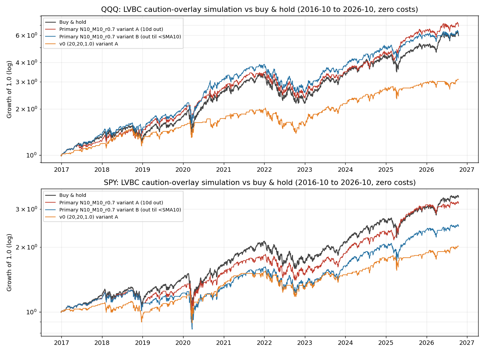

# Volume Breakout Candles (Beardo-style): README

An indicator that paints a candle when price closes through its recent range,
with the color set by how much volume the move carried. A breakout printed on
thin volume paints **yellow**. A range break printed on heavy volume paints
**lime**. The idea, in the originator's framing, is that a breakout without
volume lacks conviction.

> **Origin.** Independent reconstruction of the "volume breakout candles"
> indicator published by Beardo (@BeardoTrader on X). His own Pine Script is
> subscriber-only and was not used. The rule below was reverse-engineered from
> four of his public charts (QQQ and IGV, September to October 2026) by
> pixel-scanning every painted candle and fitting the rule against the actual
> OHLCV tape. Identification quality and the full evidence table live in the
> working papers (`LVBC.md`, `BACKTEST.md` in the project archive); the short
> version is in [The rule](#2-the-rule) and [Backtests](#6-backtests).

---

## 1. Installation

1. Open [TradingView](https://www.tradingview.com) → **Pine Editor** (bottom panel).
2. Delete the template code, paste the full contents of
   `volume_breakout_candles.pine`.
3. Click **Add to chart**. Works on any symbol and timeframe; everything in
   this document was identified and tested on **daily** bars.
4. The defaults are Beardo's fitted settings (see [Settings](#5-settings)).
   The companion file `volume_breakout_candles_strategy.pine` is a
   TradingView **strategy** version carrying the optimized-for-Chris settings
   and an exit rule, for use in TradingView's strategy tester.

---

## 2. The rule

A candle is painted when its **close** breaks the prior **20-day range**
(close above the highest high of the prior 20 sessions, or close below the
lowest low). Wick-only intraday breaks do not count. The color is a volume
split against the **20-day simple average of volume, current bar included**:

| Volume vs 20-day average | Color | Meaning |
|---|---|---|
| Below 0.90× | **Yellow** | Low-volume range break |
| 0.90× to 1.00× | unpainted | Dead zone |
| Above 1.00× | **Lime** | High-volume range break |

Both directions paint. A heavy-volume closing *breakdown* is lime, same as a
heavy-volume breakout. Two of the seven yellow candles in the identification
corpus were shooting stars (small body, long upper wick); the paint is a
volume condition applied to whatever candle prints, and the candle's own
shape is a second, independent layer. The indicator optionally labels
flagged shooting stars and hammers.

**How sure is this?** On the four source charts the rule reproduces **13 of
13 painted candles with 0 false positives and 0 misses** across 316 scanned
candle instances, including two candles Beardo dated in his own text
(QQQ, Mon Oct 5 and Tue Oct 6, 2026). Treat the parameters as a *region*,
not a point: any lookback from 14 to 23 and any yellow threshold from 0.80
to 0.95 reproduces every mark. 20 and 0.90 are the round values inside the
region. Refuted by the fit: wick-based breaks, breaks of the prior highest
close, monthly pivot crosses, and the pivot ladder drawn on his IGV chart
(the ladder is context for his trades, not the trigger). One candle
(QQQ, 2026-05-29, volume ratio 0.953) sits in a blind spot of all three QQQ
charts; if it is yellow in his original, the yellow threshold is exactly
1.00 instead of 0.90. Nothing else depends on it.

---

## 3. What it is good for

Stated at the strength the evidence earns (all figures from
[Backtests](#6-backtests), daily bars, 2016–2026, in-sample):

- **A real-time label for sponsorship.** The paint answers one question
  honestly: did this range break arrive with volume behind it or not? Used
  that way, as a posture input at highs near known levels, it is exactly
  what Beardo uses it for. He trades it level to level, it sets caution,
  it does not call the trade.
- **The bottom side is the strongest measured effect.** Low-volume
  *breakdowns* (the mirror rule) were followed by +5.72% average 10-session
  returns vs +0.81% after high-volume breakdowns, pooled across QQQ, SPY
  and IWM, with further deep drops only half as often. Selling exhaustion
  is real in this data. The sample is small (23 signals), so: promising,
  not proven. Note the wrinkle: in Beardo's own charts, bottoms show up as
  **lime climax breakdowns** (heavy volume), not as low-volume marks. The
  low-volume-breakdown mirror is included in the script, labeled untested
  against his corpus, because it never fires there.
- **Drawdown insurance at optimized settings on QQQ.** At the
  optimized-for-Chris settings (see [Settings](#5-settings)), exiting for
  10 sessions on a yellow print produced CAGR 21.8% vs 20.0% buy-and-hold
  with max drawdown −32.9% vs −35.6% over the decade, in the market 86% of
  the time. On SPY and SCHX the same family is insurance with a premium,
  not a free lunch (details in [Backtests](#6-backtests)).

**What it is not good for:**

- **Standalone top-calling, or shorting, at the fitted settings.** At
  Beardo's own parameters, pooled across QQQ, SPY and IWM, yellows were
  followed by +0.37% average 10-session returns vs +0.36% after high-volume
  breakouts: no separation, and a ≥2% dip followed *less* often after
  yellows (27.1%) than after ordinary breakouts (32.5%). 90.6% of yellows
  printed a higher high within five sessions. Shorting the signal lost
  50 to 56% over the decade in simulation. The claim "amazing for
  predicting tops" does not survive contact with the tape at his settings.
- **ASTS.** The strict settings almost never fire on it (3 signals in its
  career, none in the last two years), and its loose-setting signals do
  not separate. Single catalyst-driven names are a different volume
  regime; the indicator does not transfer.
- **IBIT / Bitcoin.** IBIT has produced zero signals at the strict
  settings in its entire listed life (unmeasurable, not negative). On
  BTC-USD the claim inverts: yellows were followed by *stronger* returns
  than high-volume breakouts.

---

## 4. How to properly use it

- **Posture, not prophecy.** A yellow at highs means the breakout lacks
  sponsorship. The correct response is Beardo's own: get cautious, stop
  chasing, trade level to level. It is not a short signal and not a
  prediction that a top is in. Most yellows resolve by the market simply
  continuing.
- **Context multiplies it.** A yellow printing *into* a drawn level
  (resistance, a pivot R1, a prior high) carries more weight than one
  printing in open air. A yellow **shooting star** (the indicator labels
  these) is the escalated form: low sponsorship *and* an intraday
  rejection. Two yellows in a few sessions escalate further. That
  escalation ladder is how Beardo's own posts read them.
- **Pair it with a regime filter.** In a confirmed uptrend (Money Line
  RISK-ON), a yellow is a caution flag: hold size, add nothing. Repeated
  yellows plus a regime flip is the combination that historically
  precedes real drawdowns. Never let a single yellow override a trend
  system.
- **If you run the strategy version,** understand its cost structure
  before trusting it: on SPY, 79% of exits at the primary settings bought
  back higher. The strategy earns its keep in a minority of large dodges.
  That is insurance mathematics, and it is only worth paying if the
  drawdowns it dodges are the ones that would have changed your behavior.
- **Daily bars.** The rule was identified on daily charts and every test
  here is daily. Intraday use is unvalidated.

---

## 5. Settings

Two parameter sets ship, deliberately not blended. Each file carries the
other set in its header.

**Beardo's fitted settings (indicator defaults).** Lookback 20, close-based
range break, volume vs SMA(volume, 20) including the current bar, yellow
below 0.90×, lime above 1.00×. These reproduce his charts. Measured
performance at these settings is in [section 3](#3-what-it-is-good-for):
no top-calling separation on the pooled indexes.

**Optimized for Chris (strategy defaults).** Lookback 10, volume vs
SMA(volume, 10), yellow below 0.70×, with the exit rule: on a yellow
print, exit to cash for 10 sessions, then re-enter. This strict corner
(volume under 0.7× a 10-day average) is the only region where return
separation vs high-volume breakouts is consistent across QQQ, SPY and IWM
(+0.59pp on 10-session forward returns), and it is the simulation winner
on QQQ. Its dip-frequency edge is weak (+2.3pp) and it fires rarely
(about 3.9 signals per symbol-year, just under the usable band). Both
facts are disclosed, not rounded away.

**SCHX exception.** Chris's large-cap proxy behaves like SPY on price
(daily correlation 0.995) but differently on this signal, because its
volume series is lumpier. On SCHX the runner-up plateau, lookback 30 /
average 20 / ratio 0.8, beats the primary set on both event separation
(+0.63pp returns, +8.65pp dip frequency, where SPY inverts at the same
cell) and simulation. Run 30/20/0.8 on SCHX specifically.

**Geometry labels** (shooting star / hammer markers) are on by default and
are cosmetic: Beardo reads the shape layer in text, the paint does not
depend on it.

---

## 6. Backtests

Method: daily OHLCV (Yahoo), 2016-10-03 to 2026-10-16, 2,524 sessions per
symbol, signals act at the signal bar's close, zero costs, 60-cell grid
(lookback 10/20/30/50 × volume average 10/20/50 × ratio 0.7 to 1.1).
Everything is **in-sample** on one bull-dominated decade in which three
crash episodes do most of the drawdown work. Full tables in the project
archive (`BACKTEST.md`); the equity curves are in `sim_equity.png`.

**Event study, pooled QQQ+SPY+IWM, at plain settings (20/20/1.0):**

| Signal | n | Fwd 10d | ≥2% dip in 10d | Higher high in 5d |
|---|---|---|---|---|
| Low-volume breakout (yellow) | 595 | +0.44% | 27.9% | 90.3% |
| High-volume breakout (control) | 381 | +0.26% | 33.9% | 83.7% |

**At Beardo's fitted threshold (20/20/0.9):** yellows n=416, fwd 10d
+0.37%, dips 27.1%; control n=560, +0.36%, dips 32.5%. No separation.

**Bottom side (20/20/1.0, pooled):** low-volume breakdowns n=23, fwd 10d
**+5.72%**, further ≥2% drop 27%; high-volume breakdowns +0.81%, further
drop 50%.

**Simulations (exit on yellow, 10 sessions out, vs buy-and-hold):**

| Symbol / settings | Strategy CAGR | B&H CAGR | Strategy maxDD | B&H maxDD |
|---|---|---|---|---|
| QQQ, optimized 10/10/0.7 | 21.8% | 20.0% | −32.9% | −35.6% |
| SPY, optimized 10/10/0.7 | 12.6% | 13.4% | −28.7% | −34.1% |
| SCHX, primary 10/10/0.7 | 11.7% | 13.2% | −29.3% | −34.3% |
| SCHX, runner-up 30/20/0.8 (variant B) | 13.9% | 13.2% | −33.4% | −34.3% |

**Per-symbol verdicts:** QQQ, the optimized corner works as tested. SPY,
insurance with a premium. SCHX, use the runner-up settings. IGV behaves
like the other indexes in the event study. ASTS, does not transfer. IBIT,
unmeasurable (no strict-setting signals since listing). BTC-USD, the
claim inverts.

---

## 7. Limitations

- **In-sample everything.** Settings were selected on the same decade
  that judged them. The optimized corner earns trust only as live
  signals accumulate from here.
- **The fitted rule is a region.** Lookback 14–23 and yellow threshold
  0.80–0.95 all reproduce his charts identically; 20 / 0.90 are the
  round representatives. A 20-day volume-percentile split and an SMA-10
  ratio also fit and cannot be excluded from this corpus.
- **Zero costs in simulation.** The strategy trades rarely (a few exits
  per year), so costs would not change the story, but they are not zero
  in life, and rebuy-higher rates (up to 79% of exits on SPY) are the
  real friction.
- **Volume data quality.** ETF volume is exchange-reported and varies by
  vendor; SCHX's lumpier series is part of why its results differ from
  SPY's. Crypto volume (BTC-USD) is an aggregate estimate.
- **The bottom mirror is untested against his charts.** It never fires
  in the identification corpus. It ships because his framework claims
  tops and bottoms, and because the pooled backtest supports the
  exhaustion logic, labeled as what it is.
- **Not financial advice.** Paint is a condition, not an order.

---

## 8. Files

| File | What |
|---|---|
| `volume_breakout_candles.pine` | The indicator, Beardo's fitted defaults |
| `volume_breakout_candles_strategy.pine` | Strategy version, optimized-for-Chris defaults, exit-10-sessions rule |
| `README.md` | This file |
| `sim_equity.png` | Simulation equity curves (QQQ and SPY, from the project archive) |

*Working papers (identification evidence, full backtest tables, pixel-scan
and backtest code) live in the project archive at
`~/workspace/beardo-analog/lvbc/` (LVBC.md, BACKTEST.md, pixel_scan.py,
fit_rule.py, backtest.py).*
